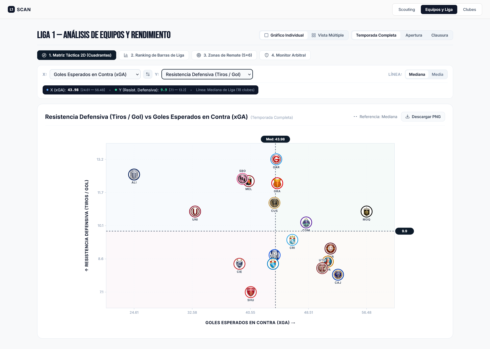
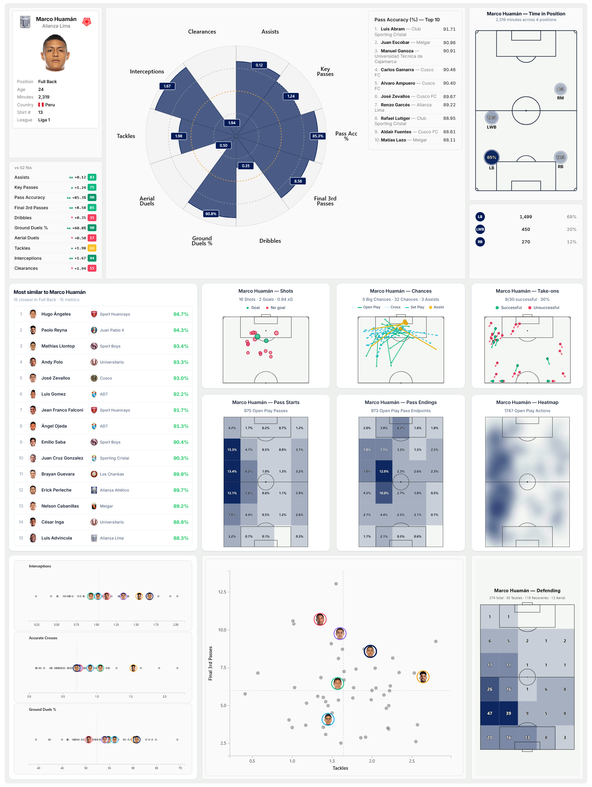
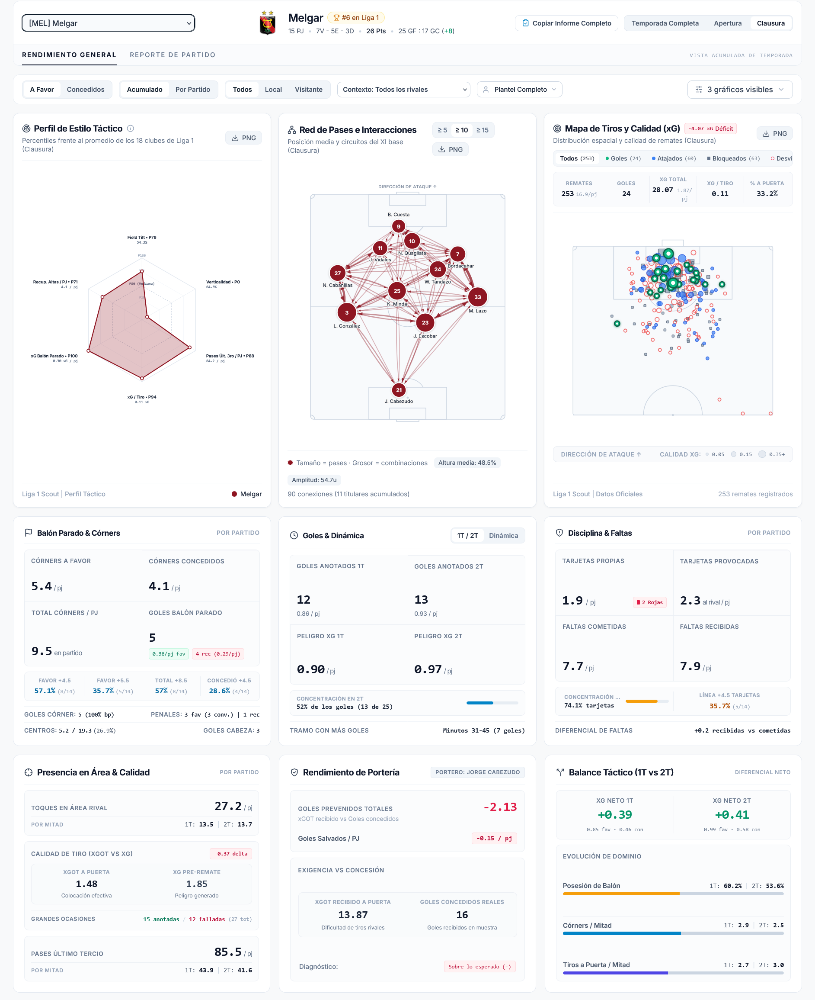
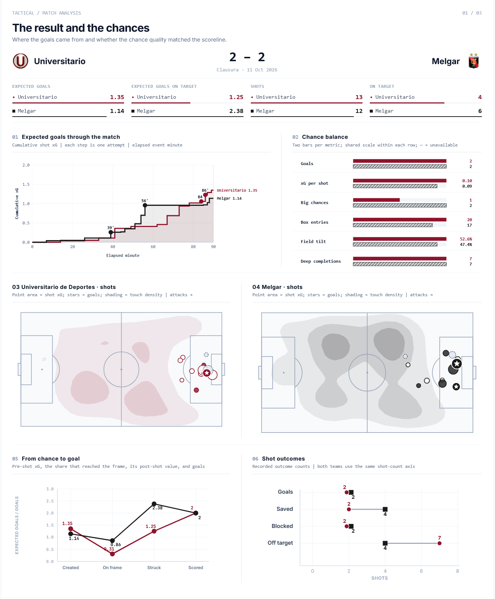

<p align="center">
  
</p>

# L1Scan

Plataforma local de scouting, análisis espacial y reportes de partido para la Liga 1 de Perú.

[](LICENSE)
[](https://www.python.org/)



---

## Instalación

### Requisitos previos
- **Python** `3.11+`
- **Node.js** `20+` y **npm**
- **Google Chrome** (necesario para cualquier extracción de datos de Sofascore)

### Pasos de configuración

1. Clonar el repositorio y crear el entorno virtual de Python:
   ```bash
   git clone https://github.com/axelstefans/l1scan.git
   cd l1scan
   python -m venv .venv
   ```

2. Activar el entorno virtual e instalar las dependencias de Python:
   ```bash
   # Windows (PowerShell)
   .\.venv\Scripts\Activate.ps1

   # Linux / macOS
   source .venv/bin/activate

   pip install -r requirements.txt
   ```

3. Instalar las dependencias del frontend:
   ```bash
   npm install --prefix frontend
   ```

4. Configurar las variables de entorno copiando `.env.example` a `.env` (`DB_PATH`, `LOG_LEVEL`) e inicializar el esquema SQLite:
   ```bash
   cp .env.example .env
   python scripts/init_db.py
   ```

5. Poblar la base de datos local eligiendo una de las dos vías:

   - **Opción A — Carga inicial rápida (~5–6 min):**
     ```bash
     python -m scraper.run --squads-only --season-stats-only --matches-only --percentiles-only
     python -m scraper.run --shotmap-only --test-mode
     ```
     - El primer comando carga clubes, plantillas, calendario y estadísticas agregadas del año (habilita de inmediato los radares y tablas de **Scouting de jugador**).
     - `--test-mode` descarga únicamente **1 partido de muestra** para validar la extracción espacial sin esperar horas.
     - Con los catálogos ya inicializados, puedes poblar jornadas completas bajo demanda con `python -m scraper.unified_runner --recent 5` (o `--round 14 --tournament Clausura`) para activar las pizarras de **Análisis de club** y **Reporte de partido**.

   - **Opción B — Histórico completo (varias horas, ~82.5 MB en disco, reanudable):**
     ```bash
     python -m scraper.run --full
     ```
     Descarga todos los eventos espaciales de las temporadas 2023–2026. Ver banderas por etapa en [`docs/SCRAPER.md`](docs/SCRAPER.md).

---

## Fuentes de datos y cobertura

Los datos provienen de **Sofascore** (eventos espaciales en coordenadas normalizadas `0–100`, mapas de tiros, estadísticas individuales y arbitraje), **Flashscore** (estadísticas colectivas por tiempo `1T`/`2T`/`ALL` vía `curl_cffi`) y **Transfermarkt** (metadatos de clubes y plantillas).

Cobertura tras ejecutar el histórico completo (corte: **noviembre 2026**):
- **Temporadas**: `2023–2026` (incluye Torneos Apertura y Clausura)
- **Partidos finalizados**: `1,253`
- **Clubes registrados**: `26` (`18` activos en la temporada 2026)
- **Jugadores**: `891`
- **Tiros geolocalizados con xG**: `23,142`

Para el desglose completo de las 28 tablas, 3 vistas SQL y conteos por entidad, consulte [`docs/DATA.md`](docs/DATA.md).

---

## Cómo se usa

### Levantar la aplicación y sincronizar jornadas

El servidor backend y el servidor de desarrollo frontend se ejecutan en **dos terminales separadas**:

1. **Terminal 1 — Backend FastAPI** en `http://localhost:8000` (conexión SQLite en modo estricto de solo lectura `mode=ro`):
   ```bash
   uvicorn api.main:app --reload --port 8000
   ```

2. **Terminal 2 — Frontend React/Vite** en `http://localhost:5173`:
   ```bash
   npm run dev --prefix frontend
   ```

3. **Actualizar jornadas recientes** o simular la ejecución sin escrituras (`--dry-run`):
   ```bash
   python -m scraper.unified_runner --recent 5
   python -m scraper.unified_runner --recent 5 --dry-run
   ```
   Para sincronizar jornadas o etapas individuales, consulte [`docs/SCRAPER.md`](docs/SCRAPER.md).

### Ejemplo de consulta a la API

```bash
curl -s "http://localhost:8000/api/teams/metrics?tournament=all"
```

El endpoint devuelve un arreglo JSON con los 18 clubes (acumulado anual Apertura + Clausura 2026 a la fecha de corte; el esquema completo está en `http://localhost:8000/docs`). Extracto del primer elemento del arreglo (Alianza Lima, 31 partidos jugados):

```json
[
  {
    "team_id": 2311,
    "name": "Alianza Lima",
    "matches_played": 31,
    "points": 65,
    "goals_scored": 52,
    "xg": 51.91,
    "xga": 24.54,
    "ppda": 8.53,
    "field_tilt": 63.0
  }
]
```

### Verificación y pruebas

```bash
# Instalar dependencias de desarrollo y ejecutar la suite de pruebas de backend
pip install -r requirements-dev.txt
pytest -q

# Verificar tipado TypeScript y empaquetado de producción del frontend
npm run build --prefix frontend
```

---

## Vistas

### Scouting de jugador



- Radar de percentiles por posición y buscador de jugadores con perfil estadístico similar.
- Seis mapas individuales en cancha: tiros, ocasiones creadas, regates, inicio y destino de pases, mapa de calor y acciones defensivas.
- Distribuciones comparativas frente a la liga y descarga de la ficha en PNG o PDF.

### Análisis de club y liga



- Filtros por torneo, condición de local/visitante, altitud o llano y nivel del rival.
- Cuatro pizarras por club (red de pases, mapa de tiros xG, carriles de ataque y territorio defensivo) más exportación de informe en Markdown.
- Comparativa de los 18 clubes mediante cuadrantes tácticos 2D, rankings de liga y monitor arbitral.

### Reporte de partido



- Tres láminas por encuentro: ocasiones y evolución minuto a minuto del xG (01), construcción y entradas al área (02) y resumen estadístico (03).
- Mapas comparativos de tiros, direcciones de pase y embudo de posesiones de ambos equipos.
- Contexto de sede y altitud, desempeño arbitral, cronología de incidencias y exportación en PNG.

---

## Modelo xG

El xG de todos los tiros se calcula con [`xg_model_pipeline.pkl`](xg_model_pipeline.pkl) (`XGBClassifier`). Los penales reciben una constante fija de `0.79` xG definida en el pipeline (la conversión histórica registrada en la base es de `78.2%`, 280 goles en 358 penales), ya que su probabilidad no depende de las coordenadas de campo.

Las métricas de entrenamiento se evalúan sobre los mismos datos utilizados para ajustar el modelo; la validación posterior fuera de muestra es la referencia de generalización.

Variables de entrada (4): distancia a portería (`distance_m`), ángulo de visión al arco (`angle_rad`), parte del cuerpo (`body_part`) y situación de juego agrupada (`situation_grouped`).

| Conjunto | Tiros (sin penales) | ROC-AUC | Brier | Log Loss |
|---|---:|---:|---:|---:|
| Entrenamiento (2023 – jul. 2026) | 18,920 | 0.8123 | 0.0719 | 0.2513 |
| Validación posterior (jul. – nov. 2026) | 3,864 | 0.7874 | 0.0729 | 0.2563 |

Calibración acumulada (incluyendo penales): `2,446.17` xG estimados frente a `2,426` goles reales en `23,142` remates.

- **Limitaciones**: el modelo utiliza solo 4 variables de evento y no incorpora posición del portero ni presión defensiva.
- **Compatibilidad y seguridad**: requiere `scikit-learn==1.9.0` y `xgboost==3.3.0`; los archivos `.pkl` cargados con `pickle`/`joblib` pueden ejecutar código arbitrario, por lo que debe cargarse únicamente el artefacto del repositorio.

---

## Más documentación

- [`docs/ARCHITECTURE.md`](docs/ARCHITECTURE.md) — Diseño interno, flujo de datos y árbol del repositorio.
- [`docs/DATA.md`](docs/DATA.md) — Esquema SQLite, catálogo de las 28 tablas y cobertura por temporada.
- [`docs/XG_MODEL.md`](docs/XG_MODEL.md) — Entrenamiento, calibración y versionado del modelo de Expected Goals.
- [`docs/SCRAPER.md`](docs/SCRAPER.md) — Comandos de ingesta por etapa, recálculo histórico y sincronización incremental.

---

## Créditos

- **Fuentes de datos**: [Sofascore](https://www.sofascore.com/), [Flashscore](https://www.flashscore.pe/) y [Transfermarkt](https://www.transfermarkt.es/).
- **Librería de extracción en Python**: [LanusStats](https://github.com/federicorabanos/LanusStats) (dependencia empleada en la ingesta de eventos y datos de partido).
- **Referencias**: [ScraperFC](https://github.com/oseymour/ScraperFC) y la comunidad abierta de analítica de fútbol en Python.

---

## Licencia y aviso de datos

Código bajo licencia [MIT](LICENSE). Los datos y logos pertenecen a sus respectivas fuentes (Sofascore, Flashscore, Transfermarkt).

`liga1.db` no se distribuye en el repositorio; `tests/fixtures/` incluye únicamente muestras mínimas para las pruebas automatizadas.

El scraping puede incumplir los términos de servicio de las fuentes y su uso es responsabilidad exclusiva del usuario.

---

## Autor

**Axel Stefano Sipion Anton** — [@axelstefans](https://github.com/axelstefans)
