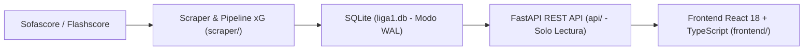

# Arquitectura Técnica — L1Scan

Este documento describe el flujo de datos, la organización del repositorio y las responsabilidades de cada capa de **L1Scan**.

---

## 1. Flujo de Datos



1. **Ingesta y normalización (`scraper/`, `scripts/`)**:
   - Extrae calendarios, alineaciones, eventos espaciales (`0–100`), incidentes (goles, tarjetas, sustituciones), estadísticas por periodo (`1T`, `2T`, `ALL`) y designaciones arbitrales desde Sofascore y Flashscore.
   - Calcula distancia (`distance_m`) y ángulo visible de portería (`angle_rad`) sobre dimensiones FIFA (`105 × 68 m`) e infiere la probabilidad de gol con `xg_model_pipeline.pkl`.
2. **Almacenamiento relacional (`liga1.db`, `migrations/`)**:
   - Base SQLite en modo `WAL` con integridad referencial activa (`PRAGMA foreign_keys=ON`).
   - El esquema evoluciona mediante archivos secuenciales en `migrations/001_*.sql` a `024_*.sql`, controlados por la tabla `schema_version` (`scraper/db.py:run_migrations`).
3. **Capa de servicios REST (`api/`)**:
   - Abre `liga1.db` exclusivamente en modo solo lectura (`file:liga1.db?mode=ro`, `uri=True`).
   - Ejecuta consultas SQL parametrizadas (`sqlite3.Row`, sin ORM) y valida respuestas mediante esquemas Pydantic v2.
4. **Cliente web (`frontend/`)**:
   - SPA en React 18 + TypeScript estricto + Tailwind CSS + TanStack Query.
   - Consume `/api/v1/*` mediante clientes modulares Axios y proyecta visualizaciones vectoriales sobre SVG.

---

## 2. Árbol del Repositorio

```text
l1scan/
├── api/                                # Backend FastAPI (conexión SQLite en solo lectura)
│   ├── core/                           # Configuración, conexión RO y catálogo de roles tácticos
│   ├── models/ & schemas/              # Contratos de entrada/salida Pydantic v2
│   ├── repositories/                   # SQL nativo (player_repo, team_repo, ranking_repo, referee_repo)
│   ├── routers/                        # Endpoints REST (players, teams, rankings, matches, referees)
│   ├── services/                       # Agregaciones analíticas (flashscore_service.py)
│   └── main.py                         # Punto de entrada ASGI y configuración CORS
├── docs/
│   └── ARCHITECTURE.md                 # Diseño interno y estructura de módulos
├── frontend/
│   ├── public/                         # Escudos de clubes (teams/) y fotos de jugadores (players/)
│   └── src/
│       ├── pages/                      # Vistas principales (Scouting, Clubes, Equipos y Liga)
│       ├── components/
│       │   ├── analytics/              # Gráficos espaciales y tarjetas de rendimiento colectivo
│       │   │   ├── pitch/              # Lienzo SVG parametrizable (SoccerPitchCanvas)
│       │   │   ├── passNetwork/        # Geometría, grafo, leyenda y tooltip de red de pases
│       │   │   ├── shotMap/            # Geometría, marcadores, filtros y KPIs de mapa de tiros
│       │   │   ├── attackZones/        # Geometría, malla de 5 carriles y KPIs de ataque
│       │   │   └── defensiveTerritory/ # Envoltura convexa, altura de bloque y acciones defensivas
│       │   ├── clubs/                  # Cabecera institucional, barra táctica y láminas de partido
│       │   │   └── sheet01/            # Submódulos gráficos de la Lámina 01 (Ocasiones y xG)
│       │   ├── scouting/               # Pisos 01-03 del dossier individual (floor02/, floor03/)
│       │   ├── referees/               # Tabla, monitor y panel de detalle arbitral
│       │   ├── layout/                 # Barra de navegación principal
│       │   └── team/                   # Tarjeta de once titular más utilizado
│       ├── hooks/                      # Hooks de datos (usePlayer, useTeam, useTeamMatchSync)
│       ├── services/
│       │   ├── api/                    # Clientes HTTP por dominio (players, teams, matches, referees)
│       │   └── clubReport/             # Generador modular de reportes Markdown por secciones
│       ├── i18n/                       # Diccionario tipado ES/EN (scoutingReport.ts)
│       └── utils/                      # Formateo de nombres Opta, geometría de radares y exportación PNG
├── migrations/                         # Migraciones SQL secuenciales (001 .. 024)
├── docs/                               # Documentación técnica (ARCHITECTURE.md, DATA.md, XG_MODEL.md, SCRAPER.md, assets/)
├── scraper/                            # Clientes HTTP, parsers y orquestador de ingesta
│   └── sources/                        # Módulos de extracción por entidad y cálculo de xG
├── scripts/                            # Inicialización de BD (init_db.py), sincronización y backfill
├── shared/                             # Modelos compartidos entre ingesta y API
├── specs/                              # Especificaciones de diseño de pipeline, backend y frontend
├── tests/                              # Suite pytest y fixtures JSON offline (tests/fixtures/)
├── .env.example                        # Plantilla de variables de entorno
├── LICENSE                             # Licencia MIT
├── requirements.txt                    # Dependencias de producción (API, scraper y modelo xG)
├── requirements-dev.txt                # Dependencias de desarrollo y testing (pytest, httpx)
└── xg_model_pipeline.pkl               # Pipeline serializado de Expected Goals (xG)
```

---

## 3. Desglose Técnico por Capa

### Backend (`api/`)
- **`api/core/database.py`**: Gestiona el ciclo de vida de la conexión SQLite por petición en modo `ro`.
- **`api/repositories/`**:
  - `player_repo.py`: Búsqueda de jugadores, estadísticas por temporada/partido, percentiles por rol, eventos espaciales individuales y cálculo de similitud.
  - `team_repo.py`: 34 métricas agregadas de club con filtros de torneo (`Apertura`, `Clausura`, `all`), condición (`home`, `away`) y contexto (`vs_elite`, `vs_rest`, `altitude`, `sea_level`), además de redes de pases, mapas de tiro, zonas de ataque, territorio defensivo y XI más utilizado.
  - `ranking_repo.py`: Clasificaciones de jugadores por métrica ajustada por 90 minutos (umbral por defecto de cohorte: `450` minutos).
  - `referee_repo.py`: Estadísticas disciplinarias por árbitro y desglose por club.
- **`api/routers/matches.py` y `matches_sheet_03.py`**: Construyen los payloads para las Láminas 01, 02 y 03 de reporte de partido (flujo xG, progresión, canales de ataque, tipología de tiros, estado de juego y resumen para portapapeles).
- **`api/services/flashscore_service.py`**: Cruza `flashscore_match_team_stats` con `matches` y `teams` para exponer métricas por mitad (`1T`, `2T`, `ALL`) y eficiencia de arquero (`xGOT` enfrentado y goles prevenidos).

### Ingesta y Base de Datos (`scraper/`, `scripts/`)
- **`scraper/db.py`**: Configura `PRAGMA journal_mode=WAL` y ejecuta `run_migrations()` comparando el prefijo numérico de `migrations/*.sql` contra `MAX(version)` en `schema_version`.
- **`scraper/sources/shotmap.py`**: Convierte coordenadas de tiro `0–100` a metros (`105 × 68 m`), calcula distancia y ángulo a portería y ejecuta `calculate_and_store_pending_xg()` sobre los tiros pendientes.
- **`scripts/sync_fecha.py` y `scripts/sync_discovered_matches.py`**: Sincronizan partidos jugados recientes desde Flashscore aplicando control de ritmo y pausa entre lotes.

### Frontend (`frontend/src/`)
- **Transporte HTTP (`services/api/`)**: Dividido en `apiClient.ts`, `playersApi.ts`, `teamsApi.ts`, `teamTacticalApi.ts`, `matchesApi.ts` y `refereesApi.ts`, re-exportados desde `services/api.ts`.
- **Primitivos Tácticos Compartidos**:
  - `components/analytics/pitch/SoccerPitchCanvas.tsx`: Lienzo SVG reutilizable (orientación vertical/horizontal, cancha completa o medio campo, temas `light`, `dark`, `tactical-dark` y `warm-ivory`).
  - `hooks/useTeamMatchSync.ts`: Sincroniza la lista de partidos de un club y valida el `match_id` activo al cambiar de equipo o torneo.
  - `utils/playerFormatters.ts`: Normaliza nombres compuestos hispanos al formato `Inicial. Apellido` (`formatOptaName`).
- **Generador de Reportes (`services/clubReport/`)**: Transforma las respuestas de la API en un objeto tipado (`ClubReportData`) y ensambla el informe en Markdown mediante `overviewAndStyleSection.ts`, `spatialAndBuildupSection.ts` y `setPiecesAndPeriodsSection.ts`.
